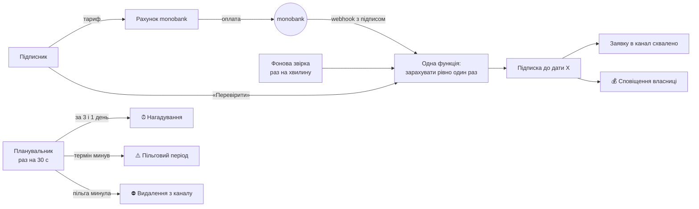

# «Сила вдома» — бот платного доступу до закритого Telegram-каналу (демо)

Telegram-бот, який **продає доступ до приватного каналу і сам стежить за підписками**: тарифи → оплата карткою (monobank) → вступ у канал → нагадування про продовження → автоматичне видалення тих, хто не продовжив. Власниця каналу лише отримує сповіщення про оплати.

Бізнес вигаданий — канал фітнес-тренерки «Сила вдома». Логіка підходить для будь-якого платного контенту в Telegram: тренери, курси, експерти, клуби, закриті спільноти.

**Спробувати:** [@fitnessPowerAtHome_bot](https://t.me/fitnessPowerAtHome_bot) → команда `/demo` підкаже, що натиснути. Оплата **тестова**: картка `4242 4242 4242 4242`, гроші не списуються. Тариф «Демо — 5 хвилин» показує весь цикл — від оплати до видалення з каналу — за 7 хвилин.

<!-- 🎥 Відео: додати посилання після запису (що бачить власниця: сповіщення, /stats, /grant) -->

---

## Що вміє

**Для підписника**
- Тарифи кнопками, оплата на захищеній сторінці monobank, рахунок у гривнях (ціна — з налаштувань, а не з кнопки, тож її не підробити).
- Після оплати — одразу в канал: бот сам схвалює заявку на вступ. Якщо людина постукала в канал **до** оплати — заявка чекає й схвалюється автоматично, щойно гроші прийдуть.
- Нагадування перед кінцем підписки (за 3 і 1 день) з кнопкою «Продовжити» в один дотик. Продовжив раніше — дні, що лишились, не згорають.
- Пільговий період після закінчення: доступ ще є, бот попереджає, і лише потім закриває.
- «📋 Моя підписка» — до якої дати діє доступ (за київським часом) і посилання на канал.

**Для власниці каналу** (адмін-група в Telegram)
- 💰 Сповіщення про кожну оплату: хто, тариф, сума, «нова / продовження / повернення після перерви».
- 👋 Хто не продовжив — щоб написати особисто.
- `/stats` — активні підписки, хто закінчується найближчими днями, виручка за сьогодні / 7 / 30 днів, конверсія «запускали бота → платили».
- `/user` — усе про людину на одному екрані (підписка, оплати зі статусами, ручні дії) — відповідь на «я заплатила, а доступу немає».
- `/grant` — видати доступ без оплати (готівка, переказ, подарунок); `/revoke` — закрити доступ (повернення коштів). Кожна ручна дія — у журналі: хто, кому, коли.

## Як це працює



## Ключові рішення (і чому)

| Рішення | Чому |
|---|---|
| **Доступ — лише після підтвердження від банку** | Натискання «Я оплатив» нічого не вирішує: бот сам питає банк про статус. |
| **Три шляхи дізнатися про оплату — одна функція** | Webhook (секунди), кнопка «Перевірити» і фонова звірка (раз на хвилину) можуть спрацювати одночасно. Зарахування — атомарний запис у базі «лише якщо ще не зараховано»: подвійного продовження і подвійного сповіщення не буде. |
| **Фонова звірка поруч із webhook** | Банк робить лише кілька спроб доставити webhook, а про прострочений рахунок не повідомляє взагалі. Webhook — швидкий шлях, звірка — надійний. |
| **Підпис webhook перевіряється першим** (ECDSA, на сирих байтах) | Адресу бота знає будь-хто. Без перевірки підпису «оплату» міг би надіслати хто завгодно; сума теж звіряється з нашою. |
| **Вступ через заявки, а не звичайне посилання** | Звичайне посилання пускає будь-кого, кому його переслали. Тут бот перевіряє **людину**, а не посилання: переслане посилання без оплати марне (а з оплатою — приводить нового клієнта). |
| **Видалення = ban + одразу unban** | Інакше Telegram тримає людину в «Видалених», і вона не повернеться навіть після оплати. |
| **Захист від гонок «оплатила саме в мить видалення»** | Кожна дія планувальника спершу «застовплюється» в базі з умовою «дата закінчення досі та, яку я бачив». Людина продовжила за цю мить → дата інша → бот нічого не робить. |
| **Порядок дій — за ціною помилки** | Загубити одне нагадування — дрібниця, надіслати п'ять однакових — спам; не видалити боржника — це гроші. Тому повідомлення не повторюються після збою, а видалення повторюється, доки не вдасться. |
| **Перевірки при старті** | Неправильний ID каналу, бракує прав, не той токен — бот не запуститься і скаже, що виправити, замість тихо зламатися на першій оплаті. |
| **Час — параметр, а не «котра година зараз»** | Логіку підписки (місяць, нагадування, пільга) тести «перемотують» за мілісекунди. Час у базі — UTC, людям — за Києвом (перехід на зимовий час не з'їдає годину). |

## Тести

`tests/` — **217 автотестів**, без інтернету: фальшивий Telegram і фальшивий банк записують, що бот «надіслав», а тест перевіряє, що побачила б людина і власниця.

- оплата: успіх, відмова, прострочений рахунок, банк недоступний, той самий webhook тричі, підроблений підпис, чужа сума;
- канал: переслане посилання, заявка до оплати, власника каналу не видаляємо;
- кінець підписки хвилина за хвилиною; перезапуск бота без дублів; бот лежав увесь пільговий період;
- гонки: оплата між рішенням і видаленням, два шляхи зарахування одночасно;
- адмінка: команди працюють лише в адмін-групі (спроба з чужої групи — ігнор).

**Мутаційна перевірка:** код навмисно ламали в ключових місцях (десятки разів) — тести мають впасти. Кожна «мутація, що вижила» означала дірку в тестах — і отримувала свій тест.

**Живі тести** в справжньому Telegram і тестовому режимі банку — чекліст [`docs/live-tests.md`](docs/live-tests.md).

## Чесно про межі

- Бот захищає **доступ**, а не **вміст**: учасник може переслати пост чи зробити скриншот. Частково допомагає налаштування каналу «Заборонити копіювання і пересилання».
- Оплата — на сторінці банку. Для цифрових товарів Telegram також пропонує власну валюту Stars — її можна додати другим способом оплати.
- Демо працює в тестовому режимі monobank. Для реального каналу — еквайринг власника (ФОП), гроші йдуть напряму йому.

## Вартість для власника

Хостинг — ~$5/міс. Комісія банку за еквайринг — за тарифом банку власника. Жодних абонплат сервісам-посередникам.

## Стек

Python 3.12 · aiogram 3 · monobank acquiring API · SQLite (`aiosqlite`) · aiohttp (webhook) · cryptography (ECDSA) · pytest · Railway

## Структура

```
bot/
├── main.py           # запуск: перевірки, база, HTTP-сервер для webhook, фонові задачі, polling
├── config.py         # налаштування з оточення (.env)
├── checks.py         # перевірки при старті: канал, права, адмін-група, банк
├── plans.py          # тарифи з data/plans.yaml
├── subscription.py   # «мозок»: статус підписки і що робити зараз (чисті функції)
├── db.py             # SQLite: оплати, підписки, заявки, журнал; міграції
├── payments/         # банк за інтерфейсом: monobank (рахунок, статус, підпис webhook)
├── billing.py        # одна функція зарахування для всіх трьох шляхів
├── webhook.py        # приймає webhook від банку
├── reconcile.py      # фонова звірка з банком
├── scheduler.py      # нагадування, «закінчилась», видалення, старі заявки
├── access.py         # посилання із заявками, схвалення, видалення з каналу
├── stats.py          # цифри для /stats
├── texts.py, admin_texts.py, keyboards.py
└── handlers/         # меню, тарифи, оплата, «моя підписка», заявки, адмін-команди
data/plans.yaml       # тарифи: ціна, тривалість, нагадування, пільга — змінюються без коду
tools/                # find_chats, check_setup, mono_try — налаштування й діагностика
tests/                # автотести
```

Під інший канал змінюється здебільшого `data/plans.yaml` і тексти.

## Запуск локально

```bash
python3.12 -m venv .venv && source .venv/bin/activate
pip install -r requirements.txt
cp .env.example .env        # заповнити BOT_TOKEN, MONO_TOKEN, SUPPORT_CONTACT
python -m tools.find_chats  # дізнатися CHANNEL_ID і ADMIN_CHAT_ID
python -m tools.check_setup # перевірити все одним запуском
python -m bot.main
```

1. Канал — **приватний**; бот — адміністратор із правами «Додавання підписників» і «Блокування користувачів» (без права додавати адмінів).
2. Адмін-група — супергрупа, бот — учасник.

Тести: `pip install -r requirements-dev.txt && python -m pytest`

## Налаштування

| Змінна | Обов'язкова | Опис |
|---|---|---|
| `BOT_TOKEN` | так | токен від @BotFather |
| `CHANNEL_ID` | так | закритий канал (`-100…`) |
| `ADMIN_CHAT_ID` | так | адмін-група для сповіщень і команд |
| `MONO_TOKEN` | так | токен еквайрингу monobank (тестовий або бойовий) |
| `SUPPORT_CONTACT` | так | контакт для питань оплати (`/paysupport`) |
| `DEMO_MODE` | ні | `1` — демо-тариф і позначки «тестова оплата» |
| `WEBHOOK_BASE_URL` | ні | публічна https-адреса бота; без неї — кнопка «Перевірити» і фонова звірка |
| `DB_PATH` | ні | файл бази (на сервері — на постійному диску, напр. `/data/bot.db`) |
| `TIMEZONE` | ні | часовий пояс для дат (за замовчуванням `Europe/Kyiv`) |
| `DEMO_VIDEO_URL`, `DEVELOPER_CONTACT` | ні | лише для демо: показуються в `/demo` |

## Що можна додати для реального каналу

- Оплата в Telegram Stars поруч із карткою.
- Автопродовження зі збереженою карткою (якщо банк підтримує регулярні платежі).
- Промокоди, пробний тиждень, кілька каналів або рівнів доступу.
- Експорт оплат у Google Sheets / CSV для обліку ФОП.
- Щоденний дайджест власниці замість окремих сповіщень.

---

Розробник: Іван Білошицький
